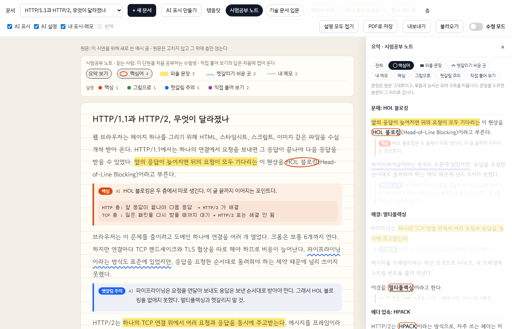
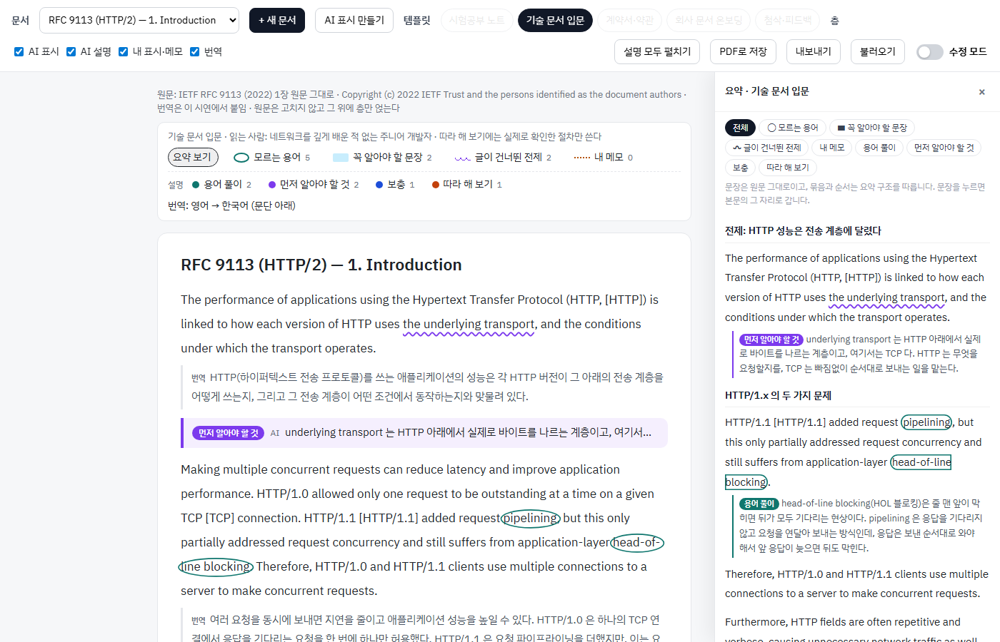
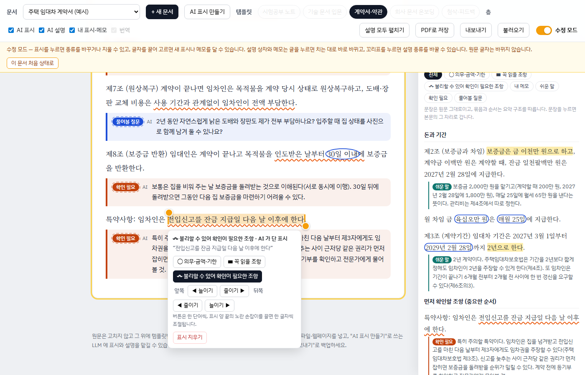

# notelayer

**어떤 자료든, 원문은 그대로 두고 그 위에 이해를 쌓는다.**

**바로 써 보기 → https://jihu0331.github.io/notelayer/**

notelayer 는 글 위에 표시(동그라미·형광펜·물결 밑줄)와 설명 상자, 번역, 내 메모를 **층**으로 얹어 읽는 문서 보기입니다.
같은 원문이라도 목적에 맞는 **템플릿**을 고르면 다른 디자인, 다른 표시, 다른 설명으로 다시 그려집니다.

> *English:* notelayer renders any document with layered annotations — circles, highlights, wavy underlines, explanation boxes, translations and your own notes — without touching the original text. Pick a purpose-built template (exam notes, tech-doc primer, contract review, onboarding, writing feedback) and the same source is re-drawn for that purpose. Annotations come from any LLM via a plain data format; nothing is sent anywhere by the app itself.



## 무엇을 하나

- **목적별 템플릿 5종** — 시험공부 노트, 기술 문서 입문, 계약서·약관, 회사 문서 온보딩, 첨삭·피드백. 템플릿마다 색·글꼴·표시 이름·설명 종류가 다릅니다.
- **모양의 뜻은 하나로 고정** — 동그라미는 핵심어, 형광펜은 중요한 문장, 물결 밑줄은 확인이 필요한 곳. 한 번 익히면 어느 템플릿에서나 읽힙니다.
- **층 켜고 끄기** — 원문 · AI 표시 · AI 설명 · 번역 · 내 표시와 메모를 따로 켜고 끕니다.
- **요약** — 범례의 "요약 보기"를 누르면 오른쪽에 표시한 문장만 모은 요약이 열립니다. 문장은 **원문 글자 그대로**이고, 묶음과 순서는 이해하기 쉽게 짭니다(문서에 요약 구조가 있으면 그 순서, 없으면 핵심어가 처음 나오는 순서로 핵심어마다 묶음). 요약 안에도 동그라미·형광펜·물결이 그대로 보이고, 메모와 설명 첫 줄이 해당 문장 아래 붙습니다.
  - 범례의 "핵심어", "외울 문장", 설명 종류 등을 누르면 요약에서 그 종류가 든 문장만 또렷하게 남고 나머지는 흐려집니다. 같은 항목을 다시 누르면 풀립니다.
  - 요약 문장을 누르면 본문의 그 자리로 갑니다.
- **수정 모드** — 오른쪽 위 스위치를 켰을 때만 고칠 수 있습니다.
  - 표시를 눌러 종류 바꾸기·지우기, 버튼으로 한 단어씩 또는 양 끝 손잡이를 끌어 한 글자씩 범위 늘이고 줄이기
  - 글자를 끌어 골라 새 표시나 내 메모 달기
  - 설명·그림·답·번역은 글을 누르면 치는 대로 바로 고쳐짐
  - 고친 것은 "내가 단 표시", "AI · 내가 고침" 으로 AI 가 만든 것과 구분됩니다
- **번역 층** — 영어 같은 외국어 문서는 문단마다 아래에 번역이 붙고, 표시와 설명은 원문 위에 그대로 남습니다.
- **직접 풀어 보기** — 시험공부 템플릿의 답은 처음에 접혀 있어 먼저 생각해 보게 합니다.
- **PDF 로 저장 · 내보내기/불러오기** — 인쇄용 PDF, 그리고 고친 내용을 파일로 백업합니다.

| 번역 층 (RFC 9113 원문) | 수정 모드 (계약서 템플릿) |
|---|---|
|  |  |

## 써 보기

설치할 것이 없습니다. [공개 데모](https://jihu0331.github.io/notelayer/)를 열거나, 저장소를 내려받아 `index.html` 을 브라우저(크롬 계열 권장)로 열면 예시 문서 다섯 개가 보입니다.
내 자료를 넣어 쓰려면 내려받아 쓰는 쪽이 편합니다.

```
git clone https://github.com/jihu0331/notelayer.git
# notelayer/index.html 을 브라우저로 열기
```

## 내 자료 넣기

화면 위쪽 **"+ 새 문서"** 에서 세 가지 방법으로 넣습니다. 넣은 문서는 "내 문서" 묶음에 들어가고, 다섯 템플릿을 모두 쓸 수 있습니다.

- **글 붙여 넣기** — 제목과 본문을 붙여 넣으면 빈 줄 기준으로 문단이 나뉩니다. 제목을 비우면 짧은 첫 줄을 제목으로 씁니다. 언어는 자동으로 알아냅니다.
- **파일** — 텍스트(.txt)·마크다운(.md)·PDF·워드(.docx)에서 글자를 뽑아 붙여 넣기 칸에 채웁니다. 파일은 브라우저 안에서만 읽습니다(PDF 는 [pdf.js](https://mozilla.github.io/pdf.js/), 워드는 [mammoth](https://github.com/mwilson/mammoth.js) 를 그때 내려받아 씁니다). 스캔한 PDF·사진 속 글씨는 읽지 못하고, 표·두 단 편집은 문단이 어긋날 수 있습니다.
- **웹페이지** — 창에 있는 "notelayer로 보내기" 버튼을 즐겨찾기 막대로 끌어다 두세요(북마클릿). 읽던 페이지에서 누르면 본문만 추려 notelayer 새 창의 새 문서가 됩니다. 확장 프로그램은 필요 없습니다. 파일로 연 notelayer(`file://`)에서 만든 버튼은 동작하지 않으니 [공개 데모](https://jihu0331.github.io/notelayer/)처럼 인터넷 주소로 연 화면에서 만드세요.

넣은 문서는 처음에 표시가 없는 깨끗한 원문입니다. 수정 모드에서 직접 표시해도 되고, 아래처럼 LLM 에 맡길 수도 있습니다.

### AI 표시 만들기

notelayer 자체는 LLM 을 부르지 않습니다(서버도 API 키도 없습니다). 쓰고 있는 ChatGPT·Claude·Gemini 와 **복사·붙여 넣기**로 주고받습니다.

1. 문서와 템플릿을 고르고 **"AI 표시 만들기"** → **"요청문 복사"**. 템플릿 규칙과 문서 문단이 담긴 요청문이 복사됩니다. 표시·설명과 함께 요약의 구조(묶음과 순서)도 요청하고, 원문이 한국어가 아니면 번역도 요청합니다.
2. LLM 에 붙여 넣고, 돌려받은 답을 그대로 창에 붙여 넣은 뒤 **"적용"**.
3. AI 표시·설명만 바뀌고 내가 단 표시와 메모는 남습니다. 원문과 글자가 다른 인용은 붙이지 않고 몇 개를 뺐는지 알려 줍니다.

### 문서 파일로 넣기 (저장소에 함께 두고 싶을 때)

1. [`prompts/annotate.md`](prompts/annotate.md) 를 LLM 에 붙여 넣고, 맨 아래에 템플릿 id 와 원문을 넣습니다.
2. 돌려받은 코드를 `documents/새이름.js` 로 저장하고 [`documents/manifest.js`](documents/manifest.js) 목록에 파일 이름을 더합니다.

표시는 **원문 문단 번호 + 원문 그대로의 인용문**으로 위치를 잡습니다. 인용문이 원문과 한 글자라도 다르면 제자리에 붙지 못하고, 화면 아래 "원래 자리를 못 찾은 표시" 목록에 남습니다.

## 데이터 모양

```js
window.NL_DOCS.push({
  id: "http-vs-http2", title: "…", lang: "ko", source: "…", templates: ["exam", "tech"],
  blocks: [{ p: 1, text: "원문 문단", tr: "번역(선택)" }],
  memos: [{ p: 3, quote: "멀티플렉싱", text: "내 메모" }],
  annotations: {
    exam: {
      marks: [{ p: 1, kind: "circle" | "highlight" | "wave", quote: "원문 그대로" }],
      boxes: [{ p: 1, label: "핵심", text: "…", pre: "글자 그림(선택)", answer: "답(선택)", by: "사람 이름(선택)" }],
      // 요약 구조(선택): 묶음 제목과, 그 묶음에 들어갈 문장을 가리키는 원문 인용. 그 문장 전체가 요약에 들어간다
      outline: [{ title: "문제: HOL 블로킹", items: [{ p: 1, quote: "앞의 응답이 늦어지면" }] }]
    }
  }
});
```

템플릿은 [`templates.js`](templates.js)(이름·표시 뜻·설명 종류·규칙)와 [`app.css`](app.css) 의 `[data-template="…"]` 변수(색·글꼴)로 정합니다. 새 템플릿은 두 곳에 같은 id 로 더하면 됩니다.

## 저장과 개인정보

- 서버가 없습니다. 넣은 문서와 고친 내용은 모두 내 브라우저 안에만 있습니다(`localStorage`). 다른 브라우저나 컴퓨터로 옮기려면 "내보내기"로 백업 파일을 만들어 "불러오기" 하세요. 백업 파일에는 내가 넣은 문서도 들어갑니다.
- 바깥으로 나가는 요청은 글꼴(Google Fonts)과, PDF·워드 파일을 넣을 때 내려받는 읽기 도구(pdf.js, mammoth)뿐입니다. 문서 내용은 어디에도 보내지 않습니다. LLM 에 보내는 것은 내가 직접 복사해 붙여 넣을 때뿐입니다.

## 예시 문서에 대해

- `rfc9113-intro.js` 는 IETF RFC 9113 1장 원문입니다. Copyright (c) 2022 IETF Trust and the persons identified as the document authors. 번역과 설명은 이 저장소에서 붙였습니다.
- 나머지 네 문서(HTTP 비교 글, 임대차 계약서, 신입 안내서, 자기소개서)는 이 저장소를 위해 새로 쓴 가상의 예시입니다. **계약서 예시의 설명은 법률 자문이 아니며**, 실제 계약에 쓰지 마세요.

## 의견

이 도구가 쓸모 있는지 확인하는 중입니다. 써 보고 좋았던 점, 불편한 점, 넣고 싶은 자료 종류나 템플릿을 [이슈](../../issues)로 남겨 주시면 큰 도움이 됩니다.

## 라이선스

[MIT](LICENSE)
